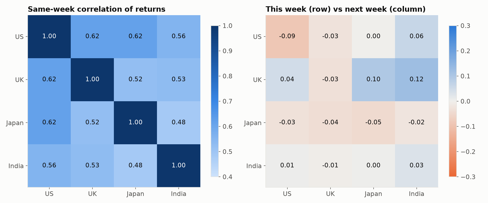
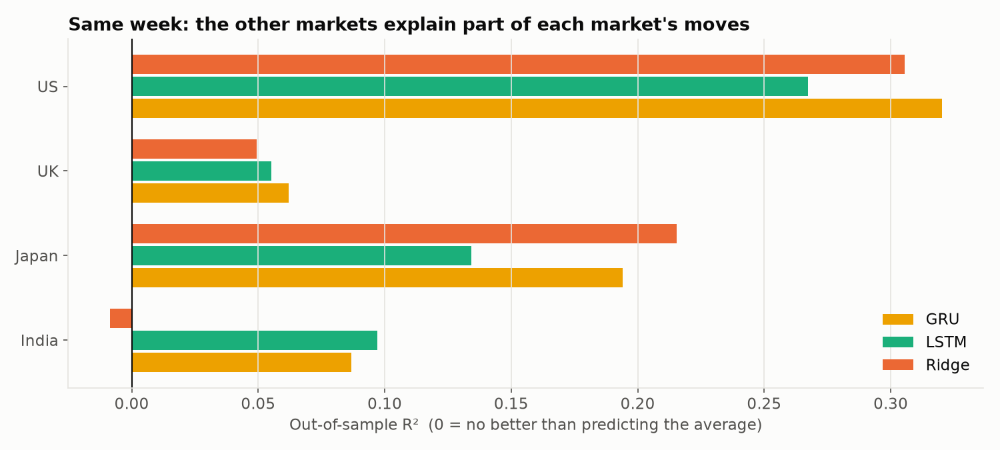
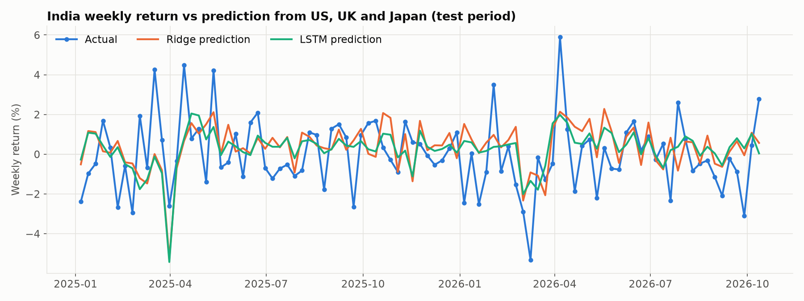
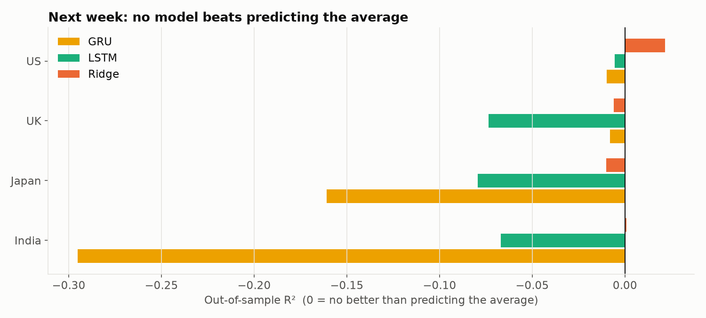
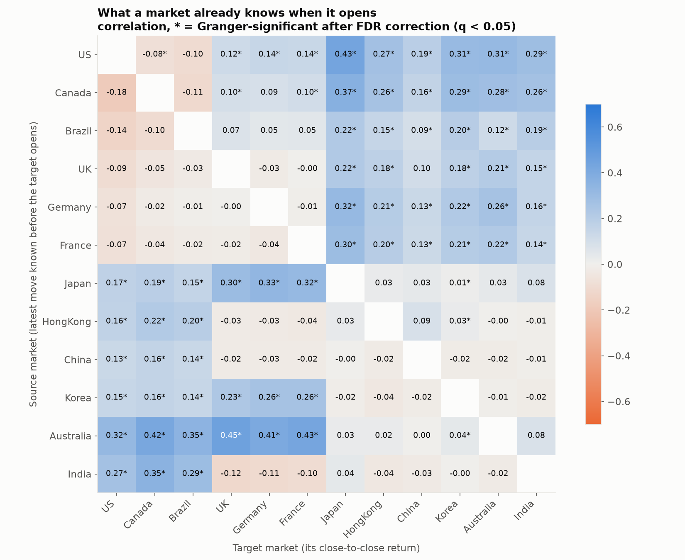
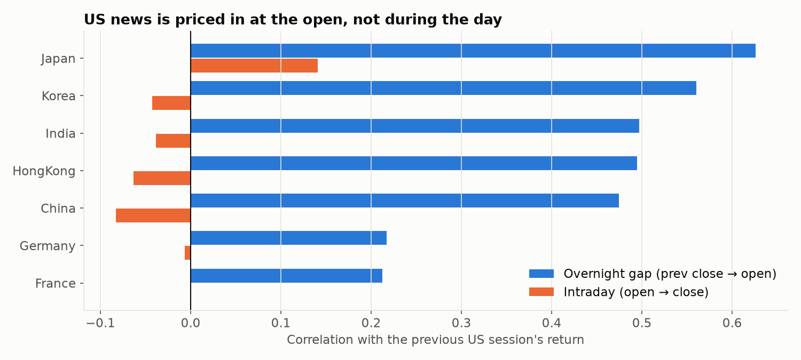
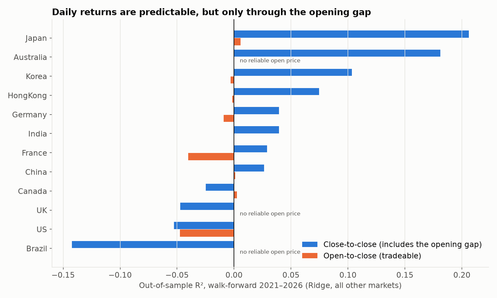
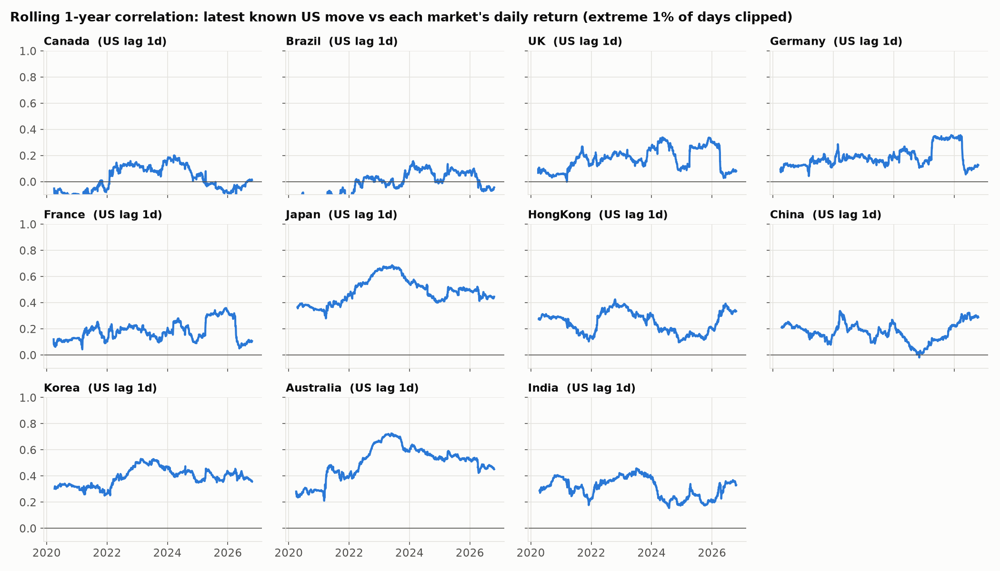
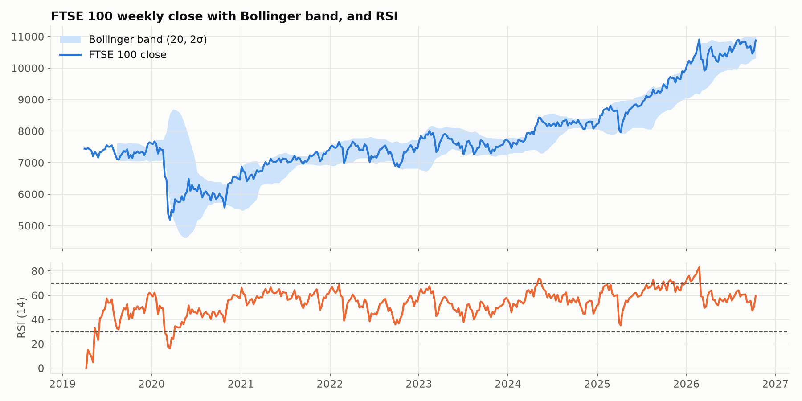

# Inter-Index Impact on Stock Markets

**Do the world's major stock markets move each other, and can that be used to predict them?**

The project has two parts:

- **Part 1 (weekly, 4 markets):** how much of one market's weekly return can be explained by the *other* markets in the same week, and can next week's return be forecast? LSTM and GRU models are compared against Ridge regression and naive baselines. All models train on 2019–2024 and are tested on 2025–2026.
- **Part 2 (daily, 12 markets, aligned by time zone):** does a market's close predict markets that open *after* it? This part adds Granger-causality tests, walk-forward retraining, Diebold–Mariano significance tests, and rolling correlations.

## TL;DR

| Question | Answer |
|---|---|
| Do markets move together? | Yes. Weekly correlations are 0.49–0.62 between the US, UK, Japan and India. |
| Can next week's return be forecast? | No. No model beats the historical average (Diebold–Mariano p > 0.05 for every target). |
| Does the US close predict Asia the next day? | **Yes, strongly.** Walk-forward R² is up to 0.33 (Australia), 0.21 (Japan) and 0.11 (Korea), all with q < 0.001. |
| Can you trade it? | **No.** The effect sits almost entirely in the **opening gap**. Once Asian markets open, the US news is already priced in. |
| Do the links stay fixed? | No. Rolling correlations drift a lot. For example, Europe's link to the US doubled during the 2025 tariff shock and then faded. |
| Do deep models help? | On weekly data (about 280 samples), no. On daily data (about 1,500 samples), the GRU beats Ridge for most Asian targets. |

---

# Part 1: Weekly, four markets

| Market | Index | Ticker |
|---|---|---|
| 🇺🇸 United States | S&P 500 | `^GSPC` |
| 🇬🇧 United Kingdom | FTSE 100 | `^FTSE` |
| 🇯🇵 Japan | Nikkei 225 | `^N225` |
| 🇮🇳 India | NIFTY 50 | `^NSEI` |

**Data:** weekly prices from Yahoo Finance, April 2019 to October 2026. After indicator warm-up, this gives 374 weeks in which all four markets traded: 278 for training (Aug 2019 to Dec 2024) and 93 for testing (Jan 2025 to Oct 2026). The data is cached in [data/](data/).

---

## Weekly Findings

### 1. Markets move together within a week, but not from one week to the next



- **Same week (left):** every pair of markets has a correlation between **0.49 and 0.62**. The US is the most connected market, and India is the least.
- **Week to week (right):** this week's return in any market says almost nothing about next week's return in any other (|r| ≤ 0.12). By the end of each week, the markets have already absorbed each other's news.

### 2. The other markets explain part of each market's weekly return



The scores are out-of-sample R² on the 93 test weeks (Jan 2025 to Oct 2026), using only the *other three* markets as inputs. An R² of 0 means a model does no better than predicting the average return.

| Target | Ridge | LSTM | GRU | Best direction accuracy |
|---|---|---|---|---|
| 🇺🇸 US | 0.31 | 0.27 | **0.32** | 75% |
| 🇯🇵 Japan | **0.22** | 0.13 | 0.19 | 63% |
| 🇮🇳 India | −0.01 | **0.10** | 0.09 | 58% |
| 🇬🇧 UK | 0.05 | 0.06 | **0.06** | 54% |

The US is the easiest market to explain from the others. The UK is barely explained at all in 2025–26, even though it was in the earlier period. Diebold–Mariano tests against the mean forecast are significant (p < 0.05) only for the US and Japan. The UK and India results could be noise.



### 3. The links change over time: for India, the UK has replaced the US

| Inputs → India (same week) | Ridge R² | LSTM R² |
|---|---|---|
| UK + Japan | −0.03 | **0.13** |
| UK only | **0.10** | 0.10 |
| US + UK + Japan | −0.01 | 0.10 |
| US + UK | 0.00 | 0.06 |
| Japan only | −0.27 | 0.02 |
| US + Japan | −0.17 | −0.02 |
| US only | −0.13 | −0.09 |

In the earlier test (trained to 2023, tested to April 2024), the US alone explained about **28%** of India's weekly moves. Trained through 2024 and tested on 2025–26, the US alone explains **none** of them (R² below 0), and every input set that helps includes the UK. The relationship between markets isn't fixed, so a model trained on one period doesn't fully carry over to the next.

### 4. Next week's return can't be forecast



The forecasting test uses all four markets' indicators for weeks up to *t* to predict week *t+1*. Here, no model consistently beats predicting the average return: every R² falls between −0.30 and +0.06. Using only a market's own history gives the same result. Weekly index returns behave close to a random walk, which is consistent with efficient markets.

### 5. Deep models don't beat linear regression here

LSTM and GRU don't consistently outperform Ridge regression, even with about 280 training weeks. Simpler models are just as good here.

---

# Part 2: Daily, 12 markets, aligned by time zone

**Markets:** S&P 500 (US), TSX (Canada), Bovespa (Brazil), FTSE 100 (UK), DAX (Germany), CAC 40 (France), Nikkei 225 (Japan), Hang Seng (Hong Kong), Shanghai Composite (China), KOSPI (Korea), ASX 200 (Australia) and NIFTY 50 (India). The data is daily, April 2019 to October 2026, with 1,974 trading dates across all markets.

### How the alignment works

Weekly data blurs *when* information arrives. Part 2 tracks it explicitly, using each exchange's trading hours in UTC (in [interindex/markets.py](interindex/markets.py)). A source market's close counts as known to a target market only if it happens **before the target opens**. The hours are conservative across daylight-saving changes, so the alignment never uses future information. For example:

- The US closes at about 21:00 UTC, and Japan opens at 00:00 UTC. So Japan's day *d* gets the US move from day *d−1*.
- Japan and Korea close by 06:30 UTC, before Europe opens at 07:00 UTC. So Europe sees *same-day* Asian moves.
- Markets have different holidays, so each source's return is accumulated across the target's holidays. Every move is counted exactly once.

### 1. Information flows west to east, then back to the Americas



Each cell shows the correlation between the source market's latest move known before the target opens (rows) and the target's close-to-close return (columns). A star means the Granger-causality test is significant after Benjamini–Hochberg FDR correction (robust HC3 errors, 5 lags). In total, **71 of 132 pairs** are significant.

- **US → Asia-Pacific:** the strongest links are Japan 0.43, Korea and Australia 0.31, and India 0.29.
- **Asia-Pacific → Europe, same day:** Australia → UK/France/Germany reaches 0.41–0.45, and Japan/Korea → Europe 0.23–0.33.
- **Within the Americas, and from Europe to the US,** links are close to zero or negative. Their trading sessions overlap, so there's nothing left to predict.

### 2. US news is priced in at the open



Each market's daily return can be split into two parts: the **overnight gap** (previous close → open) and the **intraday move** (open → close). The previous US session's return correlates **0.47–0.63** with the gap in Asian markets, but between −0.08 and +0.14 with the intraday move. Markets absorb overseas news the moment they open.

UK, Australia and Brazil are excluded from this split, because Yahoo's "Open" price for those indices is mostly just the previous close.

### 3. Walk-forward forecasts: predictable, but not tradeable



Each model is refit every January on all earlier data and forecasts the following year (2021–2026, about 1,450 test days per market). The inputs are the last 5 days of every other market's aligned return, plus the target's own past returns. The q-values come from one-sided Diebold–Mariano tests against the historical-mean forecast, FDR-corrected across all 63 tests.

| Target | Close-to-close R² (Ridge) | Close-to-close R² (GRU) | q (GRU) | Open-to-close R² (best) |
|---|---|---|---|---|
| 🇦🇺 Australia | 0.18 | **0.33** | < 0.001 | no reliable open |
| 🇯🇵 Japan | 0.21 | **0.21** | < 0.001 | 0.007 |
| 🇰🇷 Korea | 0.10 | **0.11** | < 0.001 | −0.003 |
| 🇭🇰 Hong Kong | 0.08 | **0.09** | < 0.001 | −0.002 |
| 🇮🇳 India | 0.04 | **0.06** | 0.005 | 0.000 |
| 🇨🇳 China | 0.03 | **0.04** | 0.008 | 0.001 |
| 🇩🇪 Germany | **0.04** | 0.03 | 0.37 | −0.009 |
| 🇺🇸 US | −0.05 | 0.03 | 0.20 | −0.003 |

- **Close-to-close returns** of Asia-Pacific markets are significantly predictable from the previous US session. This isn't tradeable, though: you would need to buy at the previous close, before the US news existed.
- **Open-to-close returns,** which you *could* trade, are not predictable (R² ≈ 0). The one exception is Japan, which is nominally significant (q = 0.04) but has an R² of 0.6%, and any trading costs would wipe that out. A "trade the predicted direction" strategy on open-to-close returns earns gross Sharpe ratios between −0.7 (Germany) and 1.4 (India). The positive values mostly come from the models leaning long while markets rose over 2021–26, not from real skill.
- **With daily data, the GRU beats Ridge.** It has about 1,500 training days instead of about 280 weeks, and nonlinearity helps (Australia 0.33 vs 0.18).

### 4. The links change over time



This chart shows the rolling one-year correlation between the latest known US move and each market's daily return. The most extreme 1% of days are clipped, so the COVID crash and the April 2025 tariff shock don't dominate whole windows.

- **US → Japan and Australia** rose from about 0.3 in 2020 to about 0.7 in 2023, then eased back to about 0.45.
- **US → Europe** stayed around 0.15–0.20 for years, jumped to about 0.33 through the 2025 tariff period, and then fell back.
- **US → India** weakened from about 0.45 in 2023 to about 0.20 in 2025, matching the weekly result in Part 1.

---

## Methodology (Part 1)

1. **Data:** download weekly OHLCV prices with `yfinance` and keep only the weeks in which all four markets traded.
2. **Features:** compute nine features for each market. All of them are scale-free, so they mean the same thing in 2019 as in 2024:
   - weekly return
   - RSI (14)
   - slow stochastic %K/%D
   - MACD and its signal line, as % of price
   - Bollinger %B (20, 2σ)
   - gap to the 5-week EMA
   - weekly high-low range

   
3. **Tasks:**
   - `same_week`: the inputs are the other markets' features for weeks *t−3…t*, and the target is the market's return in week *t*. The target market contributes **no** columns.
   - `next_week`: the inputs are features for weeks *t−3…t* (the target's own history is allowed), and the target is the return in week *t+1*.
4. **Evaluation:**
   - The split is by date: training on everything up to Dec 2024, testing on Jan 2025 onward.
   - The scaler is fit on training data only.
   - Metrics are RMSE (in % points), out-of-sample R² against the training mean, and direction accuracy.
5. **Models:**
   - zero-return baseline
   - training-mean baseline
   - Ridge regression (with cross-validated regularization strength)
   - LSTM and GRU in PyTorch (32 units, dropout 0.2, weight decay, early stopping), each averaged over 5 random seeds

### What changed from the first version

The first version is preserved in [archive/original_notebook.ipynb](archive/original_notebook.ipynb). It had very low test errors, but they came from these flaws:

| Problem in v1 | Fix in v2 |
|---|---|
| The target market's own Open/High/Low/Close prices were still in the inputs (target leakage). | All target-market columns are removed in the same-week task. |
| The train/test split was random, so the model trained on the future. | The split is by date: train to Dec 2024, test from 2025. |
| The scaler was fit on the full dataset. | The scaler is fit on training data only. |
| Raw price levels were used as features. | Only scale-free indicators are used. |
| There was no baseline comparison. | Zero and mean baselines are included, and R² is reported against the mean. |
| The data covered 2019–2024 only. | The data is extended to Oct 2026. |
| Each model was trained once, with no validation. | Each model uses a 5-seed ensemble with early stopping. |
| The same code was copy-pasted for each experiment. | The code is a reusable `interindex/` package plus one runner script. |

## Project Structure

```
interindex/
  data.py           weekly download + cache
  features.py       technical indicators, aligned multi-market panel
  models.py         baselines, Ridge, LSTM/GRU (PyTorch)
  experiment.py     Part 1: leak-free datasets, chronological split, metrics
  markets.py        Part 2: 12 markets with UTC trading hours
  daily.py          Part 2: daily prices, time-zone information alignment
  walkforward.py    Part 2: yearly walk-forward refits and scoring
  stats.py          Diebold-Mariano, robust Granger causality, FDR correction
run_experiments.py  Part 1 → results/*.csv, images/*.png
run_global.py       Part 2 → results/global/*.csv, images/global_*.png
Inter_Index_Impact.ipynb   step-by-step walkthrough of both parts
data/               cached weekly and daily prices
archive/            original v1 notebook
```

## How to Run

```bash
python3 -m venv inter-index-venv
source inter-index-venv/bin/activate
pip install -r requirements.txt

python run_experiments.py            # Part 1, ~1 min; uses cached data/
python run_global.py                 # Part 2, ~20 min (GRU walk-forward)
python run_global.py --no-gru        # Part 2, Ridge only, ~20 s
python run_experiments.py --refresh  # re-download prices from Yahoo (same flag for run_global.py)
jupyter nbconvert --execute --to notebook --inplace Inter_Index_Impact.ipynb
```

## Limitations & Next Steps

- **Intraday data:** an intraday dataset (or index futures, which trade overnight) would show *how fast* the US news reaches Asian prices, and whether futures move before the cash open.
- **Open prices:** better open prices for the UK, Australia and Brazil would let those markets join the gap/intraday split.
- **Trading costs and execution:** the Sharpe figures are gross. A realistic test needs transaction costs and opening-auction prices.
- **Regime models:** rolling correlations show the links shifting. A regime-switching or time-varying-parameter model could capture that directly.

## Tech Stack

Python · pandas · NumPy · yfinance · scikit-learn · statsmodels · SciPy · PyTorch · matplotlib

## License

MIT. See [LICENSE](LICENSE).
